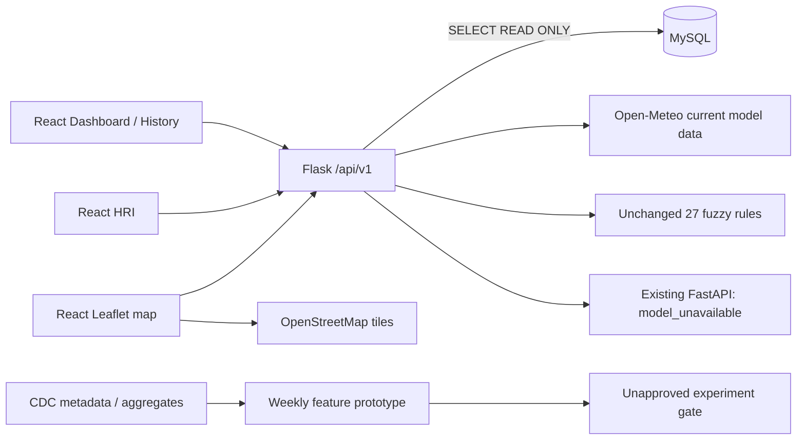
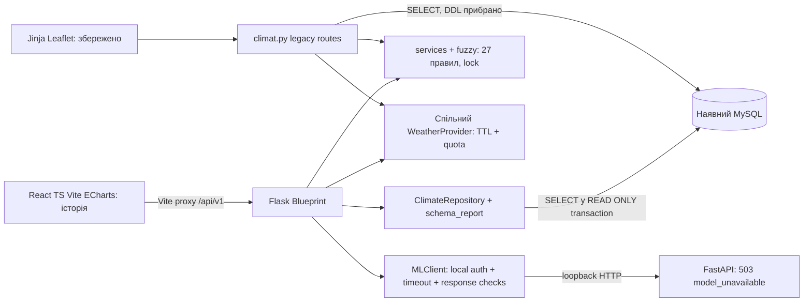
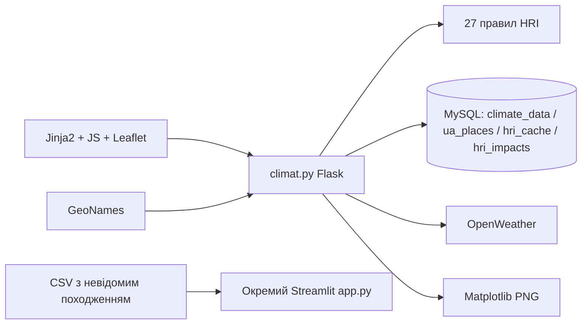
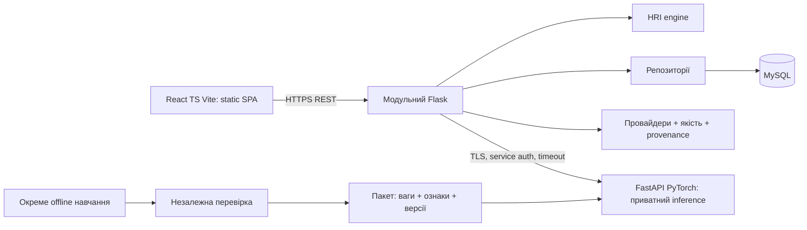
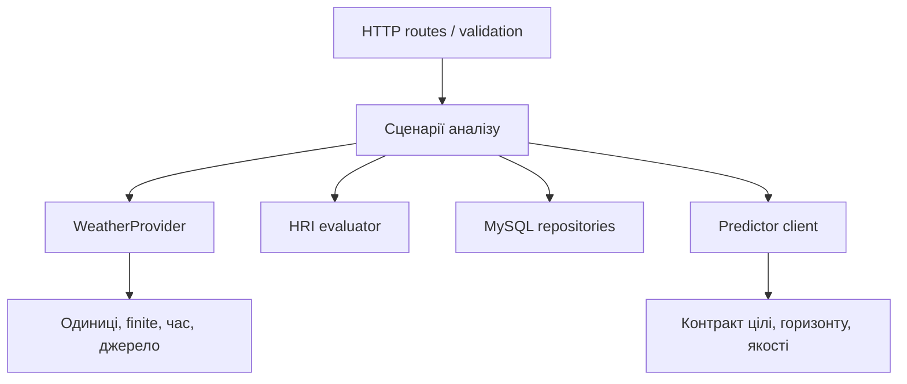
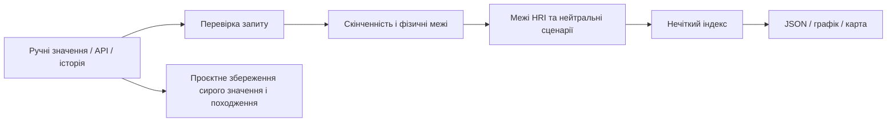
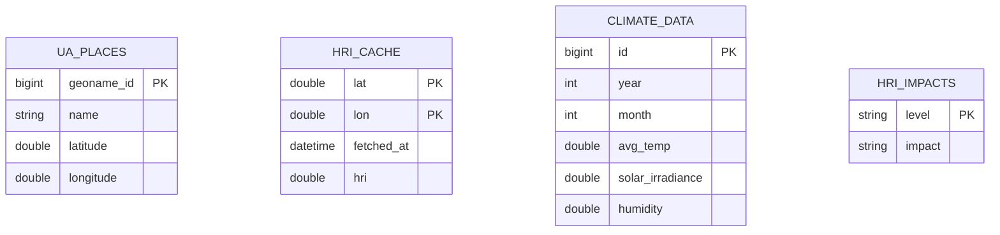

# Архітектура системи

## Поточний контур фази 3



Реалізовані Dashboard, History, HRI та Map з hash navigation. `HistoryPanel` повторно використовує reader API. `WeatherPanel` приймає MySQL place selection або явні координати, не приєднуючи до місця історію без географії. Карта завантажує до 200 місць за явним оновленням області; погода/HRI тільки для вибраного місця, не пакетно для всіх маркерів. Jinja/Leaflet збережено.

`open_meteo.py` — координатний адаптер без ключа, units/finite/time checks, TTL 300 с/256 keys, process-local 30/min і 9000/day. Restart і workers множать бюджет; це не production global quota. Новий шлях повертає модельну shortwave_radiation, legacy city OpenWeather зберігає попередню апроксимацію. HRI engine/правила не змінено. API `received_at` не підміняє provider `data_time`/`fetched_at` або час первинного історичного спостереження. `/places/search` — bounded parameterized escaped LIKE без записів/DDL.

JS client перевіряє форму відповіді, React екранує імена текстом. Leaflet/ECharts винесено в окремі chunks. `ml_pipeline/weekly.py` та experiment config — offline preparation, не predictor; missing values лишаються null, availability перевіряється до issue time, training_approved=false. Докладно: `ML_DATA_PROTOCOL.md`. Схеми нижче зберігають історичне та довгострокове обґрунтування; поточний стан визначає цей блок.

## Реалізовані уточнення фази 2



`climate_health/`: `config.py` (secret reader), `validation.py`, `fuzzy.py`, `weather.py`, `rate_limit.py`, `repository.py`, `services.py`, `api.py`, `ml_client.py`, `datasets.py`. `ml_service/app.py` — окремий локальний HTTP-процес без моделі, `frontend/src/` — перший React-сценарій. `climat.py` залишається compatibility entry point; повний application factory і виділення legacy SQL/маршрутів ще попереду. Кеш БД не записується, seed/import вимкнені. Schema baseline не застосовувався.

Реально перевірені React → MySQL і Flask → ML відображені у `PHASE2_REPORT.md`. Погодний API не перевірявся реальним ключем. API-помилки мають JSON code/message, історія використовує keyset cursor й обмежену сторінку; окремого chart endpoint не створювали — той самий набір живить таблицю та ECharts. Таблиці не мають підтвердженої географії/медичної цілі, окремої сутності регіону не вигадано.

Versioned API: 60 запитів/60 с/IP/процес; дорогі legacy analysis/HRI — 20. Спільний weather adapter: 40 зовнішніх запитів/60 с/процес, TTL 300 с, до 256 cache keys, single-flight lock; limiter зберігає до 2048 IP. Це не розподілена/місячна квота; після restart state зникає, кілька workers множать бюджет. Не довіряємо X-Forwarded-For без налаштованого proxy. Public auth/TLS та глобальні quotas ще потрібні перед deployment.

Наведені нижче схеми й дерево описують початкову структуру та довгострокову ціль. Вони не означають, що вся цільова структура вже реалізована. Docker/Terraform/хмара у фазі 2 не виконуються.

23.11.2026. Основний застосунок — цей каталог. Фізичне перенесення всього коду не виконано. Поточний стан і проєктні компоненти нижче розділено явно.

## 1. Поточна структура



Джерело MySQL для розробки надане користувачем; сервер у Docker за замовчуванням не запускається. Контрактні тести підміняють БД/API, а реальне підключення спочатку перевіряється лише читанням метаданих. DDL у старих функціях ще потребує відокремлення від запитів.

## 2. Цільовий контур — спроєктовано



## 3. Компоненти



У поточному коді більшість цих меж логічні. Нові climate_data_quality.py та ml_contract.py — ізольовані компоненти перевірок; вони не означають завершеного розділення моноліту або запуску ML HTTP.

## 4. Інформаційні потоки



HRI не є медичною міткою. Обмеження діапазону не доводить фізичну правильність. Проєктне розширення повинно зберігати сирий і обмежений вхід, ознаку заміни й метод оцінки радіації.

## 5. MySQL ER: наявне й проєктне



Між цими чотирма наявними сутностями не вигадано foreign keys. Для нового порожнього ізольованого MySQL підготовлено bootstrap SQL; це не міграція існуючого сервера. Проєктне розширення: region → weather_daily/health_daily/forecast; model_version → forecast; dataset_version → experiment. Воно потребує окремої міграції, перевірки й резервної копії. Відомості фактичного сервера переважають припущення bootstrap.

## 6. ML pipeline — спроєктовано


GRU/LSTM додаються за достатньої історії. Синтетичні fixtures перевіряють тільки програмний контракт. Реальних медичних даних і точності немає.

## 7. AWS — цільове хмарне рішення

Оновлено 24.11.2026: AWS — єдина цільова платформа. Application EC2 з HTTPS reverse proxy/React/Flask; приватний CPU AI EC2 з FastAPI/PyTorch; MySQL на EC2 або приватний RDS for MySQL. Початкова бюджетна демонстрація може об'єднати сервіси на одному EC2, без публічних ML/DB портів. Наявну локальну MySQL не змінюємо.

Актуальна рекомендація: ECS EC2 t3.small/bridge/ASG, CloudFront+private S3/OAC, ALB на demo window, RDS MySQL8.4, AIoff; [ADR0005](adr/0005-ecs-cloudfront-hcp-terraform.md). Повна [AWS-схема та приватний доступ без NAT](AWS_ARCHITECTURE.md), [три кошториси](AWS_COST_ESTIMATE.md), [ADR 0004](adr/0004-aws-infrastructure-and-credit-budget.md). Хмарні компоненти — проєктні, не реалізовані AWS-ресурси. Історичний Terraform root не використовується у цільовому deployment.

## 8. CI/CD

Програмний CI успішно працював для опублікованого 43b3ba1. Локальний UI-редизайн 4b3033b ще не відправлено. Майбутня доставка — GitHub OIDC → ECR/S3 release manifest → захищене environment → контрольоване оновлення EC2, health і rollback. State/plan/manual apply — HCP Terraform, один root і дві ізольовані workspaces, Auto Apply=false. Докладно: [CI/CD](CI_CD_PIPELINE.md), [Terraform](TERRAFORM_GUIDE.md).

Docker/Terraform jobs залишаються вимкненими. Немає створених cloud resources, автоматичного deployment, дозволу на push чи навчання моделі. Схеми вище збережені як програмний контекст; поточні cloud-рішення визначають цей розділ та ADR 0004.

## Цільова структура після перевірених етапів

```text
backend/       # маршрути, сервіси, domain, providers, repositories
frontend/      # React/TS після контракту API
ml-service/    # FastAPI inference після моделі
ml-training/   # відтворювані експерименти
infrastructure/docker/
infrastructure/terraform/
tests/
docs/adr/
scripts/
```

Ці каталоги не створено порожніми. Сьогодні climat.py, app.py і templates збережені на місці; наступне розділення виконується по одному сценарію після тестів.
