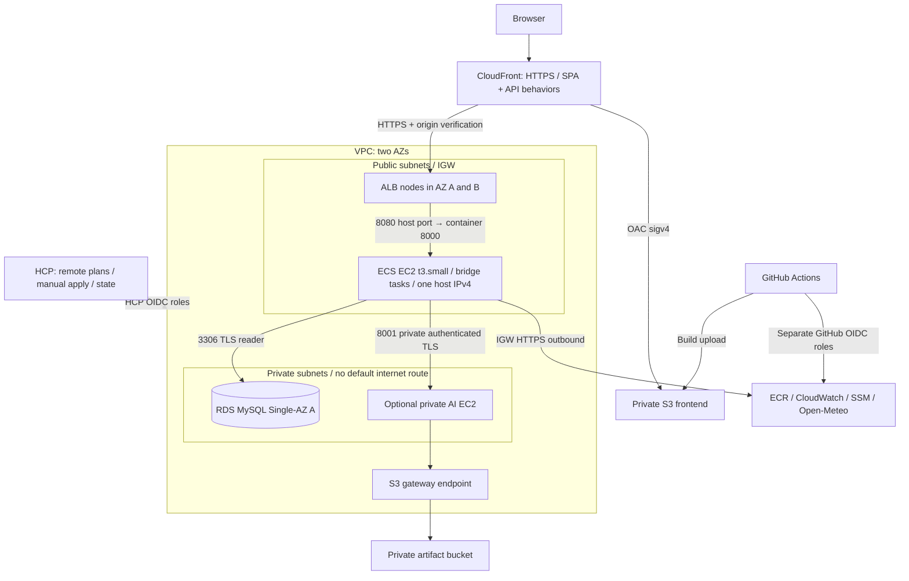

> Актуальне уточнення 26.11.2026: реалізовано [варіант B](terraform/VARIANT_B_REPORT.md): 6 modules/15 root inputs, RDS-only, AI відкладено, HCP володіє ECS revisions. Старі gates та EC2 MySQL нижче — контекст попереднього етапу. Поточні inputs/runbook/графи наведено у звіті B. Наступний крок: review diff і окреме погодження публікації; потім дозволений remote validate/Plan, не автоматичний Apply.

# ClimateHealth — ECS, CloudFront та HCP Terraform

24.11.2026. **Рекомендація, не запущена інфраструктура.** AWS, MySQL та чинний Flask/React/HRI збережені. Основний root infrastructure/terraform; попередній EC2/S3-state scaffold точно збережено в docs/history/terraform-aws-20261124 з суфіксом .historical. Немає двох активних AWS root або state migration.

## Рекомендація для демонстрації
ECS EC2 `t3.small` із AL2023 ECS-optimized AMI, ASG/Capacity Provider; приватний RDS MySQL8.4 Single-AZ; React у private S3 + CloudFront OAC; ALB тільки протягом погодженого демонстраційного вікна; **без NAT**. AI вимкнений, доки немає погодженої моделі. За потреби — private EC2 t3.small, окремий lifecycle; збільшення пам'яті лише за benchmark. Дві HCP workspaces/roles, remote plan/manual apply. Це оптимізація відтворюваності та безпечного ECS deployment для диплома, не найдешевший можливий web hosting.

Для безперервної дешевої експлуатації Compose без ALB дешевший приблизно на $24.31/730год, але потребує власного reverse proxy/certificate/origin/health/rollback. Якщо пріоритет зміниться на мінімальний постійний рахунок, обрати цей варіант окремим ADR. ALB для 80год коштує близько $2.66 і спрощує HTTPS, health та target draining; для 730год його користь треба обґрунтовувати. Поточний root реалізує ECS/ALB, **не** приховано перемикається на Compose/Fargate.

## VPC та потоки

Bridge containers use host SNAT/public IPv4 for internet egress. [EC2 awsvpc task ENIs do not receive public IPs](https://docs.aws.amazon.com/AmazonECS/latest/developerguide/networking-outbound.html): merely putting them in public subnets would break Open-Meteo. Fargate awsvpc with assignPublicIp is a different case. No public DB/AI, SSH or container port exposure; VPC private routes alone carry Backend→AI without NAT. Public host IPv4 does not imply inbound 8080 from the world.

## Backend alternatives
| Варіант | Пам'ять/CPU | Deployment та експлуатація | Висновок |
|---|---|---|---|
| ECS EC2 micro | 1 GiB, burst 2 vCPU | OS/Docker/agent/Flask конкурують за RAM; default 1024 MiB task не поміститься з reserved512 | Лише benchmark; не готова production конфігурація |
| ECS EC2 small | 2 GiB, burst 2 vCPU | ASG/CP, ECS health/circuit rollback; патчі AMI на власнику | Основний кандидат, 1 task 1024 MiB, reserved512 |
| Fargate .25/.5 | 256 CPU /512 MiB | Немає host patching, hard resource cap; Matplotlib/fuzzy RSS невідомий | Найдешевший compute, високий ризик OOM |
| Fargate .25/1 | 256 CPU /1024 MiB | Той самий ECS rollout, IP targets, task network; benchmark cold-start/latency | Серйозна наступна альтернатива, не гарантовано швидша |
| Fargate .5/1 | 512 CPU /1024 MiB | Більший CPU quota, memory не збільшується | Порівняти за throughput, не обирати автоматично |
| EC2 Compose small | 2 GiB host | Простіше, той самий EC2 тариф; self-managed health/switch/rollback/updates | Контрольний дешевший no-ALB варіант |

T3 Standard у коді: без Unlimited surcharge, але CPU throttling після вичерпання credits. Fargate — оплачений allocation, не CPU credits; ephemeral20GB включено. ECS EC2 control plane не має окремої базової compute-плати; оплачуються EC2/диск/мережа. Немає виміряної гарантії достатності RAM жодного варіанта.

### Rolling deployment
Статичний hostPort8080 і task1024 означають, що другий revision не розміщується на тому самому small host. За замовчуванням ASG max1, minHealthy0/max100: свідомий stop/start з downtime. `allow_deployment_capacity=true` піднімає max2 та minHealthy100/max200; CP/ASG може додати другий host для pending task, але boot/registration/capacity/AZ/health failure лишаються ризиками. ASG health EC2, task health /health/live, ALB /health/ready; ECS circuit breaker rollback увімкнений. Не гарантуємо zero downtime на одному host або навіть автоматичну успішність rollout без runtime тесту. 4 release ×30хв додаткового host включено як припущення до кошторису, не фіксований тариф.

ALB deregistration30с, Gunicorn graceful25с, ECS stopTimeout60с. Новий task не стає здоровим без готової MySQL. Desired app count і ASG мають погоджений stop policy. Application CD володіє task revisions; HCP — мережами/capacity/service configuration, без дублюючого apply.

## Frontend і ALB
Private S3 REST origin (не website endpoint), OAC, public-access-block, encryption/versioning. Bucket policy GetObject тільки CloudFront service з exact SourceArn. index.html no-store/max-age0 та assets content-hash + public,max-age31536000,immutable задає release pipeline; CloudFront default CachingDisabled, /assets/* окремий cache policy, /api/* CachingDisabled із cookies/query/Authorization forwarding через AllViewerExceptHostHeader. Не застосовуємо загальне 403/404→index.html до API. Viewer function переписує лише відомі SPA paths, поточний hash router збережено.

CloudFront viewer default certificate без купівлі домену; API origin — погоджене origin_hostname з ACM certificate у us-east-1, existing Route53 zone input/alias до ALB. Domain purchase/zone creation не автоматизуються. CloudFront→ALB HTTPS; listener default403 і exact verification header. ALB SG допускає тільки [CloudFront managed prefix list](https://docs.aws.amazon.com/AmazonCloudFront/latest/DeveloperGuide/restrict-access-to-load-balancer.html), його вага55 споживає SG quota; перевірити квоту перед plan. Header перевірка потрібна, бо prefix list охоплює також чужі distributions. Значення header нове на workspace, sensitive і присутнє в HCP state; не використовувати DB/API credential як header.

ALB→task HTTP у VPC не є end-to-end TLS; для чутливих медичних даних потрібен окремий TLS-to-target review, а дані нинішнього демо не погоджені до імпорту. ALB дві public AZ, ECS host один у AZ A: це не HA; мінімум2 ALB IPv4, масштабування може додати адреси. Немає публічного ML API. HTTPS certificate validity/hostname/renewal — gate, не вигадана наявна ACM конфігурація.

## Security Groups Matrix
| Source | Destination | Port | Додатковий контроль |
|---|---|---:|---|
| Internet browser | CloudFront | 443 | Viewer HTTPS |
| CloudFront origin prefix list | ALB SG | 443 | Exact header, ACM hostname; інші запити403 |
| ALB SG | Backend host SG | 8080 | bridge maps8000; лише ALB source SG |
| Backend SG | MySQL SG | 3306 | TLS/CA+hostname, reader account |
| Backend SG | AI SG | 8001 | Private TLS+service token, timeout/version checks |
| Backend host | public HTTPS services | 443 | ECR/logs/SSM/Open-Meteo, outbound only |
| AI/MySQL EC2 SG | S3 prefix list | 443 | Gateway endpoint + prefix-scoped IAM |
| Public internet | MySQL/AI/SSH | — | Немає ingress rule/public IPv4 |

IMDSv2 required, backend hop-limit1; tasks мають окрему task identity, не host credentials. Дозвіл AWS DNS resolver/IMDS має власні правила AWS і не доводить general internet access. Жодні credentials не скопійовано зі стороннього проєкту.

## NAT alternatives
| Варіант | Маршрут | Безпека/операції |
|---|---|---|
| Gateway | private0/0→managed NAT у public subnet | Погодинна+GB+IPv4 плата, один gateway — SPOF/AZ dependency; два AZ NAT збільшують fixed cost |
| t3.nano/micro NAT | private0/0→primary ENI, source_dest_check=false | ip_forward, bounded forwarding+MASQUERADE, stateful firewall, patching/replacement/CPU credits; не переносити flush FORWARD із старого script |
| No NAT | Backend bridge→host IPv4→IGW | Обрано; inbound тільки ALB. AI/MySQL приватні, S3 доступ через endpoint |
| Interface endpoints | privateHTTPS→service ENI | ECR api/dkr + S3, Logs, SSM/ssmmessages; **не** Open-Meteo. Private ECS agent може потребувати ще ecs/ecs-agent/ecs-telemetry endpoints |

NAT Instance вихідного vpc реально знайдено, але він залежить від широких правил, latest AMI та hardcoded key; не скопійовано. Для NAT alternative потрібні окремі module/tests і hardened AMI; активний root NAT не створює. S3 endpoint без погодинної плати не замінює ECR API/DKR. Базовий private AI використовує погоджений baked S3 release agent, а не runtime pip/apt/ecr pull; цей AMI agent ще не реалізовано/перевірено.

## AI та MySQL
AI: окремий private EC2 простіше для рідкісного запуску й S3 bundle; ECS EC2 з окремим AI CP дає task rollout/placement, але додаткові agent resources, discovery/network endpoints або NAT і мінімальну ASG capacity. Не розміщувати AI на backend small без benchmark. t3.small2GiB → medium4GiB → large8GiB тільки за виміряними потребами; GPU виключено.

Benchmark після погодження моделі: зафіксувати image/model/feature hashes, CPU threads1/2, batch1/8, cold-load/warm-up, 1/5/10 concurrency, 30хв навантаження; виміряти idle/peak RSS, cgroup peak/OOM, CPU credits/throttling, p50/p95/p99 latency, throughput, timeout/error, model unavailable/version mismatch і memory під час двох revisions. Порівняти baseline idle service та справжню модель окремо. Пороги визначити до експерименту (наприклад, peak<70% host RAM — запропонований gate, не результат). Навчання не запускається.

MySQL: рекомендовано RDS8.4 Single-AZ db.t4g.micro20GB encryptedgp3, backup7днів, private, secure_transport, deletion protection/final snapshot. Master password managed AWS Secrets Manager ($0.405 припущено в бюджеті); Flask використовує інший reader SSM secret. EC2 alternative — окрема private t3.small30GB із погодженою MySQL AMI та операторським backup/PITR/restore, не контейнер на переповненому micro host. Режим DB не перемикається автоматично: protection блокує видалення, потрібен окремий міграційний план. Локальну MySQL8.0.40 та дані не чіпали. RDS MySQL8.0 після31.07.2026 може створити Extended Support charges, не включені в базу.

## Реальна готовність
Root/module calls реалізовані як review code, **не перевірені Terraform**. Немає HCP connection/run/state/ресурсів. Немає image digest/погоджених AMI, TLS-aware MySQL client settings, reader/bootstrap даних, AI CA/URL/token bootstrap/agent або public access policy. Тому service_enabled=false; application_window_open=false — ALB/service не створюються, ASG0; RDS/S3/ECR/storage у майбутньому approved apply все одно можуть коштувати гроші. Закриття window через manual plan видаляє ALB/service та DNS alias, а не MySQL; це явне reviewed delete, не автоматичний destroy. Без такого окремого дозволу ALB оплачується730год.
