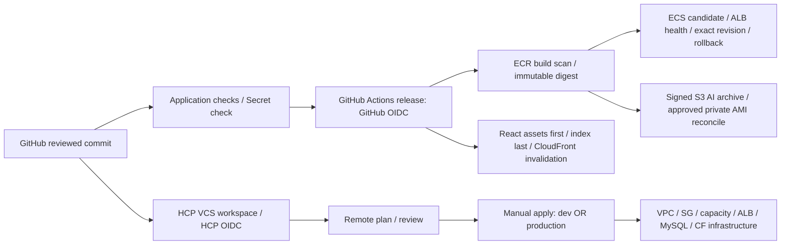

# ClimateHealth — Application CI/CD та HCP infrastructure pipeline

> Оновлення 26.11.2026: [поетапне розгортання](terraform/CONTROLLED_DEPLOYMENT.md) замінює попередні вимоги всіх runtime inputs на першому Plan. Лише environment/aws_region/name_suffix required; gates лишаються false до review. HCP володіє ECS task revisions; direct ECS deployment example лишається disabled. Авторизацію HCP не змінювати.

Оновлення шляхів 25.11.2026: source checker та обидва HCP workspaces використовують `infrastructure/terraform`; VCS trigger `/infrastructure/terraform/**` включає modules. `.github/workflows/terraform-ci.yml` виконує лише `python scripts/check_infrastructure_sources.py` з кореня репозиторію. Release draft не виконує Terraform і не залежить від попередньої вкладеності. Немає дублюючого GitHub Terraform Apply. [Звіт перенесення](TERRAFORM_ROOT_SIMPLIFICATION.md).

## Розмежування власників

Application CI з Python/React/disposable MySQL/ML/OpenAPI/security не змінено; домашні MySQL credentials до GitHub не передаються. Container job лишився if:false. `terraform-ci.yml` тепер лише manual source checks стандартним Python, без Terraform CLI/setup/provider credentials. HCP — єдиний оркестратор state/plan/apply, не дублюється GitHub Apply. Workspaces ще не підключені, remote runs відсутні.

## Підготовлений release blueprint
`infrastructure/ci/application-release.yml.example` не є активним workflow; release job додатково if:false. Після окремого погодження/перевірки його можна перенести до .github/workflows та активувати. Підготовлено frontend, backend, ai branches; всі jobs потребують protected GitHub environments dev/production, точного main/commit, успішних Application/Secret workflows для того самого SHA. Checkout/setup та aws-actions/configure-aws-credentials закріплені SHA; офіційний AWS action v6.3.0/commit прочитано через public GitHub API, evidence збережено.

Frontend: npm ci/lint/typecheck/test/build → S3 assets із immutable header, **без --delete** → index.html no-store останнім → invalidation / та/index.html. Старі hashed assets залишаються для rollback; інші non-hashed public файли повинні мати короткий TTL перед додаванням. S3 versioning дає попередній index, але реальний restore/invalidation smoke ще не виконувався.

Backend: Docker build існуючого Dockerfile → ECR immutable commit/run/attempt tag → ECR basic scan із fail-on-HIGH/CRITICAL → digest → reviewed task-definition base ARN → candidate register → update одного service → services-stable **і** exact revision check. Auto circuit rollback не вважається новим успішним release; при іншому фактичному revision pipeline повертає previous task ARN і падає. Потрібні public/read-only API/browser smoke та перевірка rollback completion перед активацією; сам cloud rollout не перевірено.

`scripts/prepare_ecs_revision.py` — offline helper: exact family/bridge, approved account/roles, immutable ECR digest; прибирає response metadata, зберігає reviewed runtime settings/secret references, не допускає plaintext credentials у environment і не викликає AWS. Його тести використовують тільки явно синтетичні фікстури. Після infrastructure task-config change людина передає `reviewed_task_definition_arn`/roles із non-sensitive HCP outputs до GitHub environment variables: GHA не читає весь state. Саме ця база, а не випадковий latest task revision, визначає memory/ports/roles. HCP ignore_changes тільки service.task_definition зберігає application ownership; не ховає SG/cache/AMI drift.

AI: новий `infrastructure/docker/ml.Dockerfile` пакує **поточний model_unavailable HTTP boundary**, не PyTorch predictor і не навчену модель. Image build/scan → ECR → Docker archive/SHA256/image ID → manifest model_status=unavailable → підпис новим environment-specific signing key → private S3 release prefix. Приватний AMI agent має перевірити підпис, archive hash/image ID, дозволені schema/model versions/availability та health до активації; agent/AMI/CA/token bootstrap ще є gate. Публікація archive не оголошується успішним inference deployment. Signing key — новий GitHub environment secret, не AWS Access Key і не ключ зі стороннього проєкту; його зараз не створювали.

## IAM
GitHub issuer token.actions.githubusercontent.com, aud sts.amazonaws.com, точний repo/environment subject; HCP issuer app.terraform.io, aud aws.workload.identity, exact org/project/workspace/run_phase. Окремі ролі: HCP dev plan/apply, production plan/apply; GitHub dev/prod release. Не AdministratorAccess, не root, не одна shared admin role.

GitHub build role: ECR push/scan/read лише двох environment repositories; GetAuthorizationToken Resource:* — обмежений виняток для цієї API. Frontend role: ListBucket та PutObject потрібних frontend prefixes, CreateInvalidation тільки свого distribution ARN. Backend deploy role: RegisterTaskDefinition (де API вимагає Resource:*), iam:PassRole **тільки** конкретних execution/task roles із iam:PassedToService=ecs-tasks.amazonaws.com; UpdateService тільки одного service ARN, необхідні Describe/Wait reads. Немає VPC/RDS/ASG/IAM policy/state permissions. AI release role може писати лише ai release-prefix artifact bucket; немає master DB secret або state access.

HCP apply роль може створювати лише відповідні environment resources, необхідні tagged roles із permissions boundary і PassRole approved profiles; plan role read-only. Повні permissions documents потребують погоджених account/ARN/region й IAM review; trust examples не є permissions grants. Secret values не зберігаються в Terraform repo/outputs, SSM data source не читає plaintext. Origin verification header знаходиться в protected HCP state; мінімальний state access обов'язковий.

## Активувати лише після погодження
HCP organization/VCS connection, plan availability/protections, account/region/cost, existing DNS zone/validated ACM origin certificate, approved image/AMI, DB reader/TLS/import/restore, runtime secret ARNs, private AI bootstrap, surge budget, health/rollback та Linux image tests. Auto Apply=false у двох workspaces. Application release no Terraform Apply/Destroy; infrastructure deletion window тільки reviewed HCP plan із явним дозволом. Пуш, локальні Docker/Terraform, HCP runs та платні ресурси зараз заборонені й не виконувалися.

Джерела: [GitHub OIDC](https://docs.github.com/en/actions/how-tos/secure-your-work/security-harden-deployments/oidc-in-aws), [HCP OIDC](https://developer.hashicorp.com/terraform/cloud-docs/dynamic-provider-credentials/aws-configuration), [CloudFront→ALB](https://docs.aws.amazon.com/AmazonCloudFront/latest/DeveloperGuide/restrict-access-to-load-balancer.html).
