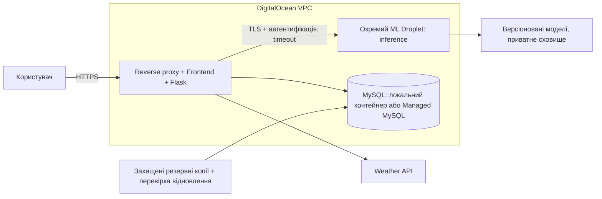

# DigitalOcean: інфраструктура і кошторис

Станом на 23.11.2026. Статус — **спроєктовано**: ресурси не створено, фактична швидкодія й тарифний рахунок не вимірювалися. Всі суми USD/місяць, без податків і можливих перевищень.

Сервер застосунку й сервер ML — окремі CPU Droplets у VPC. Cloud Firewall сервера застосунку відкриває 80/443; SSH обмежується визначеними адміністративними CIDR. Правило ML дозволяє порт лише з application Droplet, але сам процес також має слухати приватний IP і перевіряти ідентичність клієнта та транспортне шифрування; ні автентифікацію, ні TLS цей Terraform-каркас ще не реалізує. Публічний IP Droplet може існувати: мережеве правило обмежує сервіс, але не усуває потреби в OS firewall та перевірці на місці. Для обох серверів потрібні окремі секрети, журнали, health checks і перевірка оновлень.

MySQL у контейнері на сервері застосунку зменшує щомісячні витрати, але вимагає регулярних узгоджених backup, шифрування, контрольованого відновлення, оновлення та моніторингу. Managed MySQL зменшує операційне навантаження та пропонує керовані резервні функції; single-node не забезпечує високої доступності. Для production вибір має залежати від RPO/RTO і бюджету, а резервні копії необхідно періодично відновлювати на ізольованому стенді. Мережевий доступ — лише від application Droplet, не від ML та не від усього інтернету. Managed MySQL ще не описано ресурсом Terraform; ціна наведена для порівняння.

## Орієнтовна вартість

| Компонент | Припущення | USD/міс |
|---|---|---:|
| Application Droplet | Basic 1 vCPU / 2 GiB | 12,00 |
| ML Droplet | Basic 1 vCPU / 2 GiB, CPU inference; відповідність моделі RAM не перевірена | 12,00 |
| Резервні копії Droplets | weekly Basic 20% від $24 | 4,80 |
| Spaces | Standard, 250 GiB включено | 5,00 |
| MySQL у Docker | окремої плати за продукт немає; споживає RAM і диск сервера | 0,00 |
| DO Container Registry | Starter 1 repo / 500 MiB; чи вміститься образ — не перевірено | 0,00 |
| Разом з контейнерною MySQL | за перелічених припущень | **33,80** |
| Managed MySQL | single-node Basic 1 GiB, додатково до $33,80 | **+15,15 = 48,95** |
| DOCR Basic | 5 repositories / 5 GiB, якщо Starter недостатній | +5,00 |

GPU зараз не обґрунтований: немає навченої моделі чи виміряного навантаження. Якщо ресурсомістке навчання справді знадобиться, тимчасовий RTX 4000 Ada on-demand коштує $0,76/GPU-год за опублікованим тарифом, приблизно $7,60 за 10 годин; доступність у регіоні й повна конфігурація потребують перевірки. Альтернатива — локальне/тимчасове навчання та CPU inference. Вартість щоденних backups — 30% вартості Droplet, а не 20%; вихід за включені обсяги Spaces/трафіку й збільшення диска або розміру Droplet оплачуються додатково. VPC/Cloud Firewall у базовій конфігурації не додають окремої плати; перевірити актуальні умови обраної конфігурації.

Офіційні джерела: [Droplets](https://www.digitalocean.com/pricing/droplets), [MySQL](https://www.digitalocean.com/pricing/managed-databases), [MySQL pricing details](https://docs.digitalocean.com/products/databases/mysql/details/pricing/), [backups](https://docs.digitalocean.com/products/backups/details/pricing/), [Spaces](https://docs.digitalocean.com/products/spaces/details/pricing/), [Container Registry](https://www.digitalocean.com/pricing/container-registry), [GPU](https://www.digitalocean.com/pricing/gpu-droplets), [firewalls](https://docs.digitalocean.com/products/networking/firewalls/how-to/configure-rules/). Вартість уточнюється перед замовленням.

Для простого початкового спостереження достатні structured logs, health endpoints, DigitalOcean CPU/RAM/диск і uptime checks. Prometheus/Grafana розглядати після появи потреби в історичних application/ML metrics. Похибка ML вимірюється лише після надходження справжніх затверджених міток; drift сам по собі не вимірює точність моделі.
