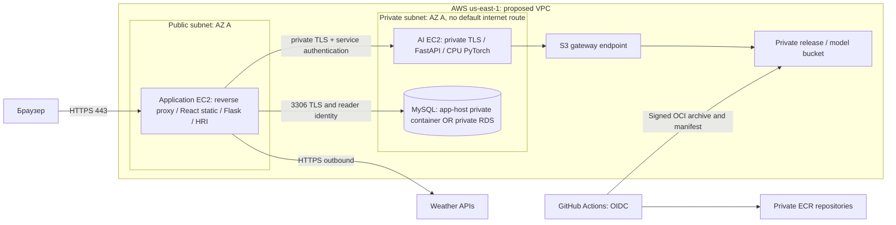

# ClimateHealth — AWS-архітектура

24.11.2026. **Проєктні рішення, не опис запущеної інфраструктури.** Проєкт — «Диплом»; система — ClimateHealth; GitHub — ClimateHealth-Monitoring. Фізичні директорії не перейменовуються. Стек і дизайн-система незмінні.

## Цільовий контур двох EC2

MySQL на application EC2 у сценарії B фізично розташована на app-вузлі, а не на окремій EC2; на схемі DB показує логічну роль. У сценарії C RDS використовує DB subnet group щонайменше у двох AZ, але сам Single-AZ DB instance розміщується в AZ A для мінімізації міжзонного трафіку. Другу AZ не видаємо за HA.

## Початкова демонстрація
Один x86 EC2 t3.medium: reverse proxy із HTTPS, React dist, Flask, приватні Compose-сервіси MySQL та FastAPI. Для БД немає host-published порту; ML також не публікується. Бюджет — без гарантії достатності 4 GiB RAM: перед створенням виміряти RSS Flask/Matplotlib, MySQL і CPU PyTorch. ML-модель досі відсутня; endpoint повертає model_unavailable, без фіктивного inference. Навчання не входить до deployment.

## Мережа та доступ
| Компонент | Вхід | Вихід |
|---|---|---|
| App EC2 | 443 від користувачів; 80 лише ACME/redirect | HTTPS weather/ECR/SSM; приватний ML:8001; MySQL:3306 |
| AI EC2 | TLS:8001 лише від application SG | HTTPS лише S3 prefix list через gateway endpoint |
| RDS MySQL | 3306 лише від application SG, publicly_accessible=false | Сервісний контур AWS; не інтернет-проксі |
| MySQL на app | Тільки внутрішня Compose network | Регламентовані backup, не зовнішній порт |

У AI немає public IPv4, IPv6 default route, NAT або Internet Gateway route. SG identity не замінює service auth/TLS. SG сам по собі не робить HTTP захищеним; reverse proxy/mTLS або перевірений внутрішній сертифікат — окремий deployment gate. Для RDS — require_secure_transport, перевірка CA/hostname клієнтом; нинішній PyMySQL ще потребує окремого перевіреного TLS-налаштування перед хмарою. Жодне домашнє root-підключення не використовують у deployment або GitHub.

Public SSH не відкривається за замовчуванням. App адмініструється через SSM із мінімальною instance role, MFA/federation та аудитом; AI без SSM endpoints не може вважатися доступним для SSM. Базовий AI працює за pull-based S3 release protocol із baked deployment agent; аварійне відновлення — заміна вузла з перевіреної AMI. Інтерактивний приватний доступ або SSM endpoints потребують окремого рішення й кошторису. Немає непомітного bastion/NAT proxy через app.

## Приватний AI без NAT Gateway
[S3 gateway endpoint](https://docs.aws.amazon.com/vpc/latest/privatelink/vpc-endpoints-s3.html) не має погодинної плати; лишаються тарифи S3. Він не надає доступу до PyPI, OS repositories, ECR API/DKR, SSM або CloudWatch Logs.

Пропонований відтворюваний протокол:
1. Погоджений CI будує й сканує образ, публікує в ECR за digest, а той самий release пакує як OCI/Docker archive до приватного S3. Це майбутнє виконання, не поточний workflow.
2. Manifest містить commit, image digest, SHA-256 архіву, модель/feature schema version, допустимий попередній release, підпис та строк чинності. Довірений ключ перевірки вбудований в AMI. IAM write-prefix доступний тільки захищеній release role; tag latest не є довірчим якорем.
3. AI має IMDSv2-only instance profile із s3:GetObject тільки свого environment-prefix. Короткі credentials надходять з IMDS, не потребують виклику STS з AI. Bucket та endpoint policies обмежують доступ. Вузол перевіряє manifest, підпис/хеші, локально завантажує архів і запускає candidate; невдалий health check повертає попередній digest.
4. Docker/Python/OS updates готуються у новій AMI або перевірених S3 release bundles. Немає runtime pip install або зовнішнього завантаження моделей. Перший deployment agent/AMI також треба створити й перевірити окремо, це не реалізовано цим каркасом.
5. AI зберігає bounded local logs. Передавання redacted журналів у власний S3 prefix потребує окремих write permissions та доповнення нинішньої read-only endpoint policy; у каркасі цього немає. CloudWatch push потребував би logs endpoint. App може збирати приватний health/status, без медичних даних у логах.

Прямий ECR pull приватним вузлом потребує [ECR API, ECR DKR та S3 endpoints](https://docs.aws.amazon.com/AmazonECR/latest/userguide/vpc-endpoints.html). Два interface endpoints в одній AZ — близько $14.60/місяць плюс data processing; додаткові logs/SSM endpoints збільшують суму. Це альтернативний сценарій, не прихована частина базового бюджету.

## MySQL: два варіанти
| Критерій | MySQL на EC2 | RDS for MySQL Single-AZ |
|---|---|---|
| Початкова вартість | Використовує RAM/CPU app та EBS | Окремі instance/storage/можливі додаткові оплати |
| Операційна робота | Патчі ОС/БД, backup, binlog/PITR, restore виконує оператор | Керовані операції, але політики backup/restore/версій контролює власник |
| Відмова | Спільна із застосунком | Окремий сервіс; Single-AZ не HA |
| Безпека | Internal network, secret files, TLS | Private endpoint, app-only SG, CA verification, reader account |
| Відновлення | Узгоджений dump + binlogs і перевірений restore | Automated backup/PITR за політикою та реальний restore drill |
| Сумісність | Потрібно перевіряти image/version/collation | Пропонується 8.4 LTS після тестів, без автоматичного переносу локальної БД |

Локальна MySQL залишається єдиною БД розробки, тільки read-only у поточному завданні. Хмарна копія потребує окремого дозволу на експорт/імпорт, мінімального dataset із дозволеною публікацією, резервної копії, reader account, перевірки звіряння та окремого плану переходу. Жодного RDS із прямим доступом до домашньої мережі.

## Межі
Немає створених AWS-ресурсів, domain/TLS setup, готового deployment agent, RDS TLS client settings чи виміряної потужності inference. Перед публічним запуском потрібні public-auth decision, trusted reverse-proxy settings, глобальні provider quotas або обмежений один worker, backup/restore, секрети та перевірені health/rollback. Будь-яка зміна працездатного коду — окремий наступний крок із тестами.
