# ClimateHealth — CI та майбутній GitHub Actions → AWS

24.11.2026. Репозиторій ClimateHealth-Monitoring, main. Опублікована фаза 3 має успішні Application checks і Secret check для 43b3ba1. Локальний коміт редизайну 4b3033b не відправлено; цей AWS-пакет також не відправлявся. Remote CI для локальних змін не запускався.

## Активний CI зберігається
Python 3.12: dependency/pip checks, Ruff/format, unit/API/ML contracts, OpenAPI, loopback Flask → FastAPI без моделі, vulnerability audit; React Node 24: npm ci, ESLint, TypeScript, component tests, build, audit; окремий secret scan staged+history. MySQL write tests — тільки disposable GitHub-hosted service; жодного доступу до домашньої БД або credentials. Чинні action SHA не змінювалися.

Container job лишається if:false. Terraform job manual-only/if:false, переведений на AWS paths. Дозвіл на виконання Docker/Terraform або AWS CD відсутній. Нових активних deployment workflows немає.

## Майбутня доставка

```mermaid
flowchart LR
  PR[PR: no AWS identity] --> CI[Python / React / contracts / security]
  CI --> MAIN[Reviewed main commit]
  MAIN --> BUILD[Approved build: scan + ECR image digest]
  BUILD --> MANIFEST[Signed release manifest + archive in private S3]
  MANIFEST --> DEV[Protected aws-dev: candidate + health]
  DEV --> REVIEW[Production reviewer + same commit/digest/plan]
  REVIEW --> PROD[Controlled EC2 update]
  PROD --> CHECK[Public app / private ML / read-only MySQL checks]
  CHECK --> RB[Failure: previous verified release]
```

## OIDC та IAM
[GitHub AWS OIDC](https://docs.github.com/en/actions/how-tos/secure-your-work/security-harden-deployments/oidc-in-aws): issuer token.actions.githubusercontent.com, audience sts.amazonaws.com. Trust policy перевіряє точний sub; для production: `repo:BohdanHavran/ClimateHealth-Monitoring:environment:production`. Для branch-bound build role — точний `repo:BohdanHavran/ClimateHealth-Monitoring:ref:refs/heads/main`. Не wildcard owner/repo/PR.

Для environment-bound sub branch не закодована в sub; потрібні environment deployment branch rules тільки main, required reviewers, prevent self-review де підтримується. Перевірити доступність protection rules для тарифу/visibility репозиторію; якщо недоступні, production workflow не активувати без іншого незалежного gate. `id-token:write` давати лише конкретним trusted jobs, `contents:read`; PR/forks/pull_request_target не отримують AWS ролі. Pin action SHA, обмежити session duration та audience, не друкувати токени.

Trust example: [aws-production-trust.json.example](../infrastructure/ci/aws-production-trust.json.example). Це лише trust, **не** grant deployment permissions і не створений IAM provider/role. Root credentials та довгострокові AWS Access Keys не потрібні.

| Роль | Дозволені дії | Обмеження |
|---|---|---|
| Bootstrap operator | Керування одним state bucket/IAM bootstrap за окремим plan | MFA/federation, не CI deploy роль |
| CI build/release | ECR push тільки двох environment repos; запис release-prefix S3 | ECR GetAuthorizationToken потребує Resource:* тільки для цієї дії; repository actions на конкретних ARN, без IAM/VPC/RDS |
| Terraform plan | Read-only inventory потрібних AWS services + state read і native lock | Окрема роль, без EC2 create/terminate/RDS modify; state policy не означає cloud permissions |
| Terraform apply | Тільки погоджені типи ресурсів/account/region з tags та permissions boundary | Не AdministratorAccess, не iam:*, iam:PassRole лише approved profiles, не root |
| App deploy | Лише контрольований SSM document на app instances з Project/Environment tags | Не unrestricted AWS-RunShellScript; не доступ до локальної MySQL |
| App instance | ECR pull, потрібний SSM, вузькі secret/backup paths | Немає state-bucket або model-release write |
| AI instance | S3 read environment release/model prefix; IMDSv2 | Немає public IP, state/ECR write, DB access; S3 log write — окреме майбутнє право |

Повні identity policies потребують реальних account/ARN/region/document names і threat review, тому не додається фіктивний «готовий» Administrator policy. [Приклад state scope](../infrastructure/ci/aws-state-policy.json.example) забороняє DeleteObject state, дозволяючи його тільки для lockfile.

## Artifact/release і контроль EC2
- ECR image digest immutable; manifest пов'язує app/ML versions, SHA-256 архіву, model/features schema, commit і попередній release. Ненавчений ML повертає model_unavailable; release не додає неіснуючої моделі.
- App має вихідний HTTPS до SSM/ECR; оновлення виконує лише перевірений deployment document із digest allow-list. Приватний AI не має SSM/ECR interface endpoints у базовому бюджеті; він завантажує підписаний S3 archive через baked pull-agent. Цей агент і document ще не реалізовано.
- Секрети не в image, Git, user_data або Terraform variables/state. Runtime secret files/approved parameter store scope та перезапуск/ротація проєктуються окремо; SSM SecureString може мати KMS-виклики й потребує маршруту для приватного AI. Не припускаємо такий маршрут без endpoints; AI service token можна доставляти окремим зашифрованим погодженим release channel до запуску.
- Candidate на іншому loopback port → liveness/readiness, read-only MySQL/schema/API, HRI contract, private ML auth + expected 503, browser smoke → переключення proxy. Немає одночасного auto-release обох вузлів без перевірки backward compatibility. Перед оновленням врахувати RAM для двох процесів; за її нестачі погодити короткий downtime замість вигаданої zero-downtime гарантії.
- При невдачі повернути попередні pinned image/config/model digests і повторити health; dataset/schema changes не відкотяться контейнером. DB migrations у deploy за замовчуванням заборонені, окремий backup/approval.
- Monitoring: CPU credit/RAM/disk, TLS expiry, provider quotas, timeouts/5xx, model/version/data status; без персональних медичних записів. Збір на приватному AI через S3 або app scraping, не неіснуючий CloudWatch endpoint.

## Перед активацією
Окремі дозволи на push, виконання CI Docker/Terraform, bootstrap, billable plan/apply та production release; перевірені credits/Budgets, backups, domain/TLS, IAM, Linux images й rollback. Зараз дозволено лише готувати та читати конфігурації.
