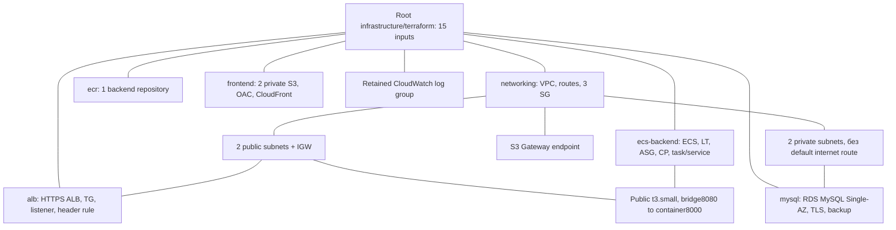

# AWS architecture — поточний варіант B

26.11.2026. Схема вихідного коду, не розгорнутої AWS. Повний статичний граф має 199 вузлів/543 ребра; 55 AWS blocks. Розміщення нижче не визначає Terraform DAG. [Точні залежності](DEPENDENCY_GRAPH.md).

networking/ecr/frontend/mysql/logs завжди присутні в конфігурації. alb/backend та origin DNS лише deploy_application=true; CloudFront тоді додає API origin. AI/EC2 MySQL/security module відсутні; 3 SG та6rules належать networking. CloudFront + bucket policies, IAM policies та task definition залежать від конкретних outputs; точний source граф показує ці ребра, а не штучну послідовність VPC→SG→ALB→ECS для всіх блоків.

ASG керує host EBS/ENI/EC2, ECS CP — managed alarms/scaling; RDS керує master secret. Ці service-managed objects не видаються за додаткові Terraform blocks. Модель/AI runtime відкладені. [Reuse matrix](VARIANT_B_REUSE.md), [runbook](VARIANT_B_REPORT.md).
