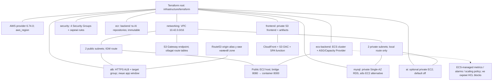

# Архітектура ClimateHealth: що саме описує код

25.11.2026. Аналіз лише активного `infrastructure/terraform`. Це схема конфігурації, не розгорнутої AWS-системи. Graphify 0.9.104 має HCL extractor, але фактичний виклик для 21 файла не дав вузлів через відсутній tree_sitter_hcl. Нижче — ручна архітектурна проєкція, звірена з власним source graph; не результат Terraform Plan.

Лінії тут означають архітектурні відношення/розміщення, а не гарантований порядок створення. Фактичні traversals і depends_on — в [dependency graph](DEPENDENCY_GRAPH.md). Передача API traffic — в [network graph](NETWORK_GRAPH.md).

## Пояснення модулів

| Root call → каталог | Призначення та важливе обмеження |
|---|---|
| module.networking → modules/networking | VPC, дві AZ, чотири subnet, публічний default route/IGW, приватна route table та S3 Gateway. NAT/interface endpoints немає; локальний VPC route зʼєднує backend із DB/AI. |
| module.security → modules/security | ALB443 тільки CloudFront prefix; backend8080 тільки ALB; MySQL3306/AI8001 тільки backend; outbound443 backend до інтернету, DB/AI тільки S3 prefix. SG rules — network policy, не доказ налаштованого HTTP/TLS сервісу. |
| module.ecr → modules/ecr | Два repositories створюються навіть при AI off; без images storage fee немає, tagged image retention не обмежено lifecycle untagged-only. |
| module.alb → modules/alb | Чотири блоки: ALB/TG/listener/rule, root count залежить від application_window_open. Public ALB, regional ACM передається ззовні, default403 і secret origin header. |
| module.frontend → modules/frontend | Два приватні buckets, policies/BPA/versioning/SSE/ownership; CloudFront OAC/cache/SPAroutes. Створюється незалежно від application window. API origin hostname — string input, не посилання на ALB/DNS resource. |
| module.backend → modules/ecs-backend | Cluster, IAM, logs, launch template, ASG/CP, initial task definition і conditional service. EC2 capacity залежить від service_enabled && window; service object — від window. Фіксований host port та RAM обмежують rolling deployment. |
| module.database → modules/mysql | Root call зветься database. Mode rds створює private RDS/subnet/parameter groups, mode ec2 — EC2/IAM/profile. RDS не залежить від service/window gates, а EC2 має prevent_destroy. |
| module.ai → modules/ai | Private EC2 + role/policy/profile лише ai_enabled=true. Немає встановлення PyTorch/model agent/service; це контракт approved AMI, а не готовий inference deployment. |

## Що знаходиться поза цим root

Існуючі DNS zone/ACM certificate, HCP connection/авторизація, IAM permissions boundary, SSM reader credentials, образы/AMI, datasets, DB import/backup procedure та AI release agent. Авторизація вже налаштована користувачем; аудит її не перевіряв і не змінював. Route53 record не купує домен і не створює hosted zone. RDS master secret керується AWS, окремий reader root не створює. CloudWatch alarms/AWS Budgets не реалізовані ресурсами, хоча в попередньому кошторисі є резерв на monitoring.

Код має 69 resource blocks:68 AWS і 1 вбудований terraform_data. Це не кількість створених instances: count/for_each розгортаються лише з конкретними inputs, а review gate з default false навмисно зупиняє Plan. Повна інвентаризація: [ресурси](RESOURCES_AUDIT.md), [змінні](VARIABLES_REFERENCE.md), [висновки](AUDIT_REPORT.md).

## Обʼєкти AWS поза окремими HCL blocks

ASG створює EC2 instances, root EBS та ENIs; ALB керує власними ENIs/public IPv4; RDS керує master secret та внутрішніми компонентами. Це не окремі Terraform declarations у цьому root. ECR images, S3 objects та log streams зʼявляються від application/runtime операцій, не від самого repository/bucket/log group block.

ECS managed scaling створює керовані CloudWatch metrics, low/high alarms і target tracking policy; може знадобитися наявна service-linked role AWSServiceRoleForECS. [Офіційна схема AWS](https://docs.aws.amazon.com/AmazonECS/latest/developerguide/cluster-auto-scaling.html). Ці service-managed objects не додано як вигадані Terraform resource dependencies у DOT. Окремих application/budget alert resources у HCL немає; фактичні monitoring charges та platform side effects треба перевірити після окремо погодженого deployment.

## Умови після виправлень26.11

ECR/S3: artifacts_provisioned; MySQL: database_provisioned; CloudFront: edge_provisioned; ALB/DNS/API origin: application_window_open; ECS конфігурація: backend_provisioned; EC2/task capacity: service_enabled і window; AI instance: ai_provisioned + ai_runtime_reviewed, його power state: ai_enabled. Default усі false, крім постійної мережевої композиції, заблокованої infrastructure_reviewed.
