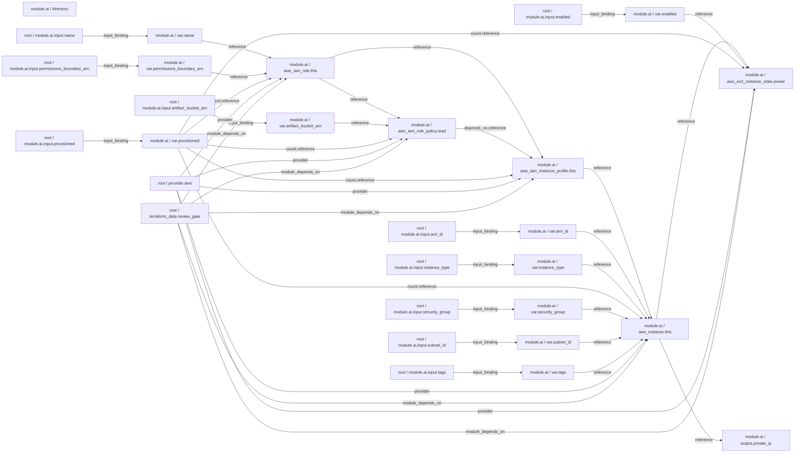
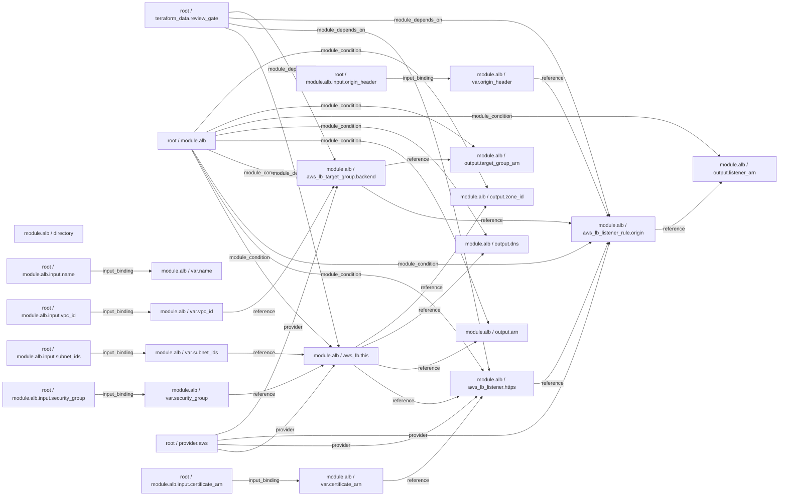
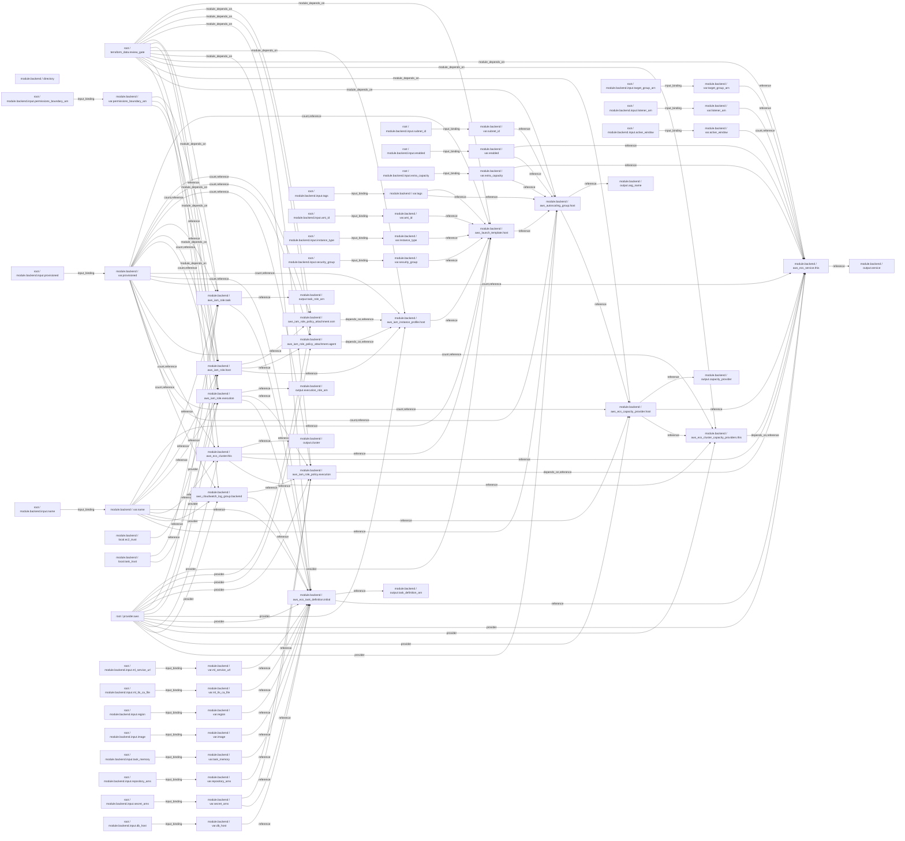
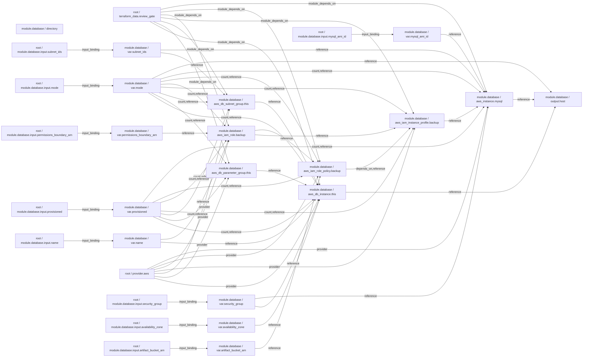
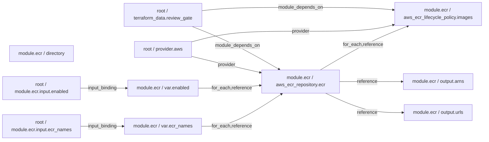
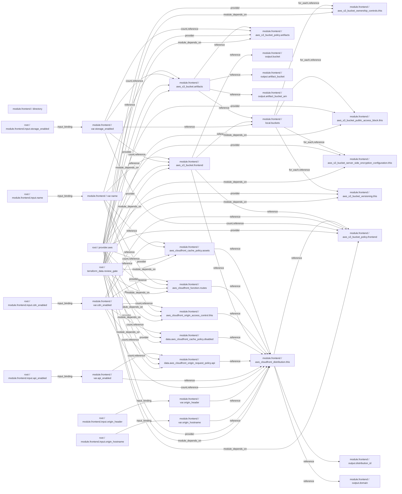
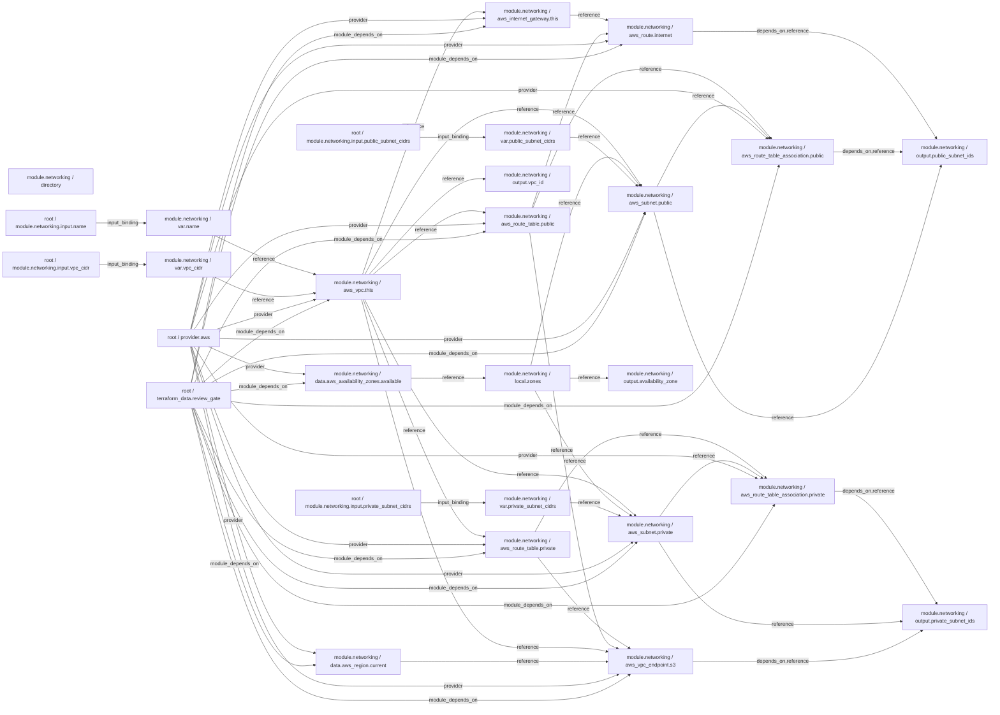
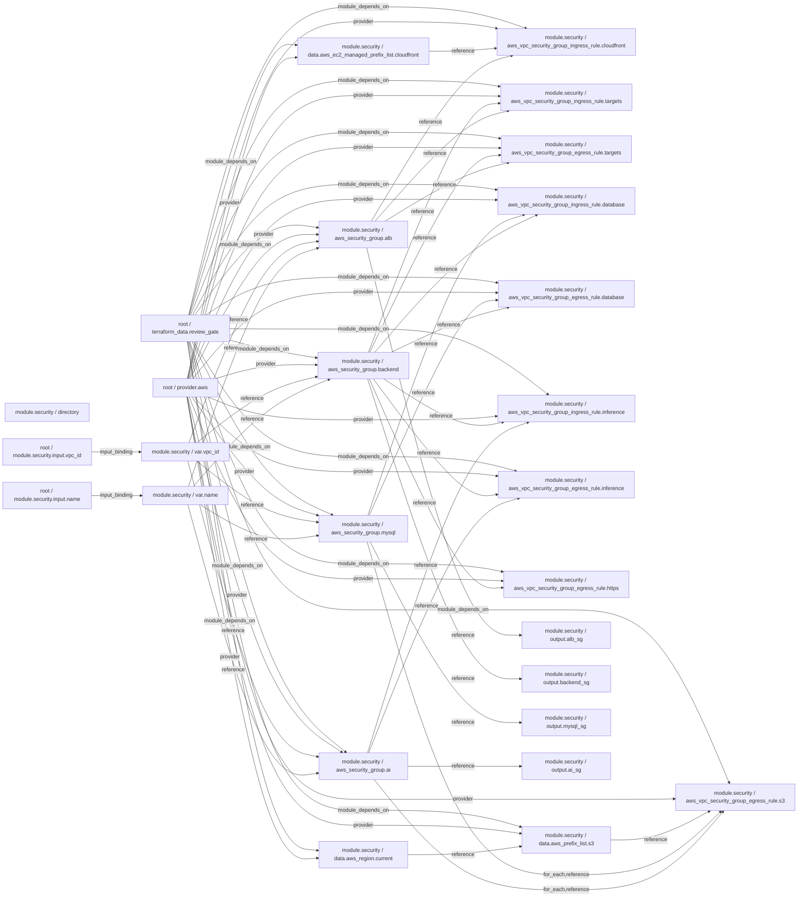

# Terraform Dependency Graph

Метод: власний offline lexical/static аналіз HCL. Graphify0.9.104 викликано, але його HCL extractor не працює без tree_sitter_hcl; пакет не встановлювався. Це НЕ terraform graph/Plan та не provider validation.

Стрілка A → B означає «B залежить від A». contains/module_source — лише структура, вони не визначають виконання. provider — успадкування root AWS provider. input_expression → input_binding показує реальну передачу input до child variable; module output references привʼязано до конкретного child output. count/for_each і module_condition залишають умовні вузли символічними, без розгортання instances. depends_on та module_depends_on — явні барʼєри.

Повний граф усіх видів вузлів: [DOT](terraform-dependencies.dot), [JSON з file/line/evidence](terraform-inventory.json). Нижче граф розбито за scopes для читабельності та обмежень Mermaid GitHub. Кожен scope включає свої вузли й зовнішні джерела залежностей; мережеві звʼязки показані ОКРЕМО в NETWORK_GRAPH.md.

## module.ai

## module.alb

## module.backend

## module.database

## module.ecr

## module.frontend

## module.networking

## module.security

## root

```mermaid
flowchart LR
  n0["root / directory"]
  n1["root / data.aws_caller_identity.current"]
  n2["root / local.name"]
  n3["root / local.tags"]
  n4["root / terraform_data.review_gate"]
  n5["root / module.networking"]
  n6["root / module.ecr"]
  n7["root / module.security"]
  n8["root / module.database"]
  n9["root / module.frontend"]
  n10["root / module.alb"]
  n11["root / module.backend"]
  n12["root / module.ai"]
  n13["root / aws_route53_record.origin"]
  n14["module.ai / output.private_ip"]
  n15["module.alb / output.target_group_arn"]
  n16["module.alb / output.listener_arn"]
  n17["module.alb / output.dns"]
  n18["module.alb / output.zone_id"]
  n19["module.alb / output.arn"]
  n20["module.ecr / output.arns"]
  n21["module.ecr / output.urls"]
  n22["module.backend / output.cluster"]
  n23["module.backend / output.service"]
  n24["module.backend / output.task_definition_arn"]
  n25["module.backend / output.task_role_arn"]
  n26["module.backend / output.execution_role_arn"]
  n27["module.backend / output.asg_name"]
  n28["module.backend / output.capacity_provider"]
  n29["module.frontend / output.domain"]
  n30["module.frontend / output.distribution_id"]
  n31["module.frontend / output.bucket"]
  n32["module.frontend / output.artifact_bucket"]
  n33["module.frontend / output.artifact_bucket_arn"]
  n34["module.database / output.host"]
  n35["module.networking / output.vpc_id"]
  n36["module.networking / output.public_subnet_ids"]
  n37["module.networking / output.private_subnet_ids"]
  n38["module.networking / output.availability_zone"]
  n39["module.security / output.alb_sg"]
  n40["module.security / output.backend_sg"]
  n41["module.security / output.mysql_sg"]
  n42["module.security / output.ai_sg"]
  n43["root / output.vpc_id"]
  n44["root / output.cloudfront_domain"]
  n45["root / output.cloudfront_distribution_id"]
  n46["root / output.frontend_bucket"]
  n47["root / output.artifact_bucket"]
  n48["root / output.alb_dns"]
  n49["root / output.ecs_cluster"]
  n50["root / output.ecs_service"]
  n51["root / output.ecr_urls"]
  n52["root / output.database_endpoint"]
  n53["root / output.ai_private_ip"]
  n54["root / output.reviewed_task_definition_arn"]
  n55["root / output.backend_task_role_arn"]
  n56["root / output.backend_execution_role_arn"]
  n57["root / output.alb_arn"]
  n58["root / output.target_group_arn"]
  n59["root / output.backend_asg"]
  n60["root / output.capacity_provider"]
  n61["root / output.private_subnet_ids"]
  n62["root / provider.aws"]
  n63["root / var.environment"]
  n64["root / var.aws_region"]
  n65["root / var.name_suffix"]
  n66["root / var.infrastructure_reviewed"]
  n67["root / var.service_enabled"]
  n68["root / var.backend_image"]
  n69["root / var.ecs_ami_id"]
  n70["root / var.backend_instance_type"]
  n71["root / var.task_memory_mib"]
  n72["root / var.allow_deployment_capacity"]
  n73["root / var.origin_hostname"]
  n74["root / var.origin_certificate_arn"]
  n75["root / var.origin_verification_header"]
  n76["root / var.runtime_secret_arns"]
  n77["root / var.database_mode"]
  n78["root / var.mysql_ami_id"]
  n79["root / var.ai_enabled"]
  n80["root / var.ai_ami_id"]
  n81["root / var.ai_instance_type"]
  n82["root / var.application_window_open"]
  n83["root / var.origin_zone_id"]
  n84["root / var.permissions_boundary_arn"]
  n85["root / var.vpc_cidr"]
  n86["root / var.public_subnet_cidrs"]
  n87["root / var.private_subnet_cidrs"]
  n88["root / var.artifacts_provisioned"]
  n89["root / var.database_provisioned"]
  n90["root / var.edge_provisioned"]
  n91["root / var.backend_provisioned"]
  n92["root / var.ai_provisioned"]
  n93["root / var.ai_runtime_reviewed"]
  n94["root / var.ml_service_url"]
  n95["root / var.ml_tls_ca_file"]
  n96["root / module.networking.input.name"]
  n97["root / module.networking.input.vpc_cidr"]
  n98["root / module.networking.input.public_subnet_cidrs"]
  n99["root / module.networking.input.private_subnet_cidrs"]
  n100["root / module.ecr.input.enabled"]
  n101["root / module.ecr.input.ecr_names"]
  n102["root / module.security.input.name"]
  n103["root / module.security.input.vpc_id"]
  n104["root / module.database.input.provisioned"]
  n105["root / module.database.input.permissions_boundary_arn"]
  n106["root / module.database.input.name"]
  n107["root / module.database.input.mode"]
  n108["root / module.database.input.subnet_ids"]
  n109["root / module.database.input.security_group"]
  n110["root / module.database.input.availability_zone"]
  n111["root / module.database.input.mysql_ami_id"]
  n112["root / module.database.input.artifact_bucket_arn"]
  n113["root / module.frontend.input.storage_enabled"]
  n114["root / module.frontend.input.cdn_enabled"]
  n115["root / module.frontend.input.api_enabled"]
  n116["root / module.frontend.input.name"]
  n117["root / module.frontend.input.origin_hostname"]
  n118["root / module.frontend.input.origin_header"]
  n119["root / module.alb.input.name"]
  n120["root / module.alb.input.vpc_id"]
  n121["root / module.alb.input.subnet_ids"]
  n122["root / module.alb.input.security_group"]
  n123["root / module.alb.input.certificate_arn"]
  n124["root / module.alb.input.origin_header"]
  n125["root / module.backend.input.provisioned"]
  n126["root / module.backend.input.tags"]
  n127["root / module.backend.input.ml_service_url"]
  n128["root / module.backend.input.ml_tls_ca_file"]
  n129["root / module.backend.input.permissions_boundary_arn"]
  n130["root / module.backend.input.name"]
  n131["root / module.backend.input.region"]
  n132["root / module.backend.input.ami_id"]
  n133["root / module.backend.input.instance_type"]
  n134["root / module.backend.input.subnet_id"]
  n135["root / module.backend.input.security_group"]
  n136["root / module.backend.input.target_group_arn"]
  n137["root / module.backend.input.listener_arn"]
  n138["root / module.backend.input.image"]
  n139["root / module.backend.input.enabled"]
  n140["root / module.backend.input.active_window"]
  n141["root / module.backend.input.task_memory"]
  n142["root / module.backend.input.extra_capacity"]
  n143["root / module.backend.input.repository_arns"]
  n144["root / module.backend.input.secret_arns"]
  n145["root / module.backend.input.db_host"]
  n146["root / module.ai.input.provisioned"]
  n147["root / module.ai.input.tags"]
  n148["root / module.ai.input.permissions_boundary_arn"]
  n149["root / module.ai.input.name"]
  n150["root / module.ai.input.enabled"]
  n151["root / module.ai.input.ami_id"]
  n152["root / module.ai.input.instance_type"]
  n153["root / module.ai.input.subnet_id"]
  n154["root / module.ai.input.security_group"]
  n155["root / module.ai.input.artifact_bucket_arn"]
  n14 -->|"reference"| n53
  n19 -->|"reference"| n57
  n17 -->|"reference"| n13
  n17 -->|"reference"| n48
  n16 -->|"reference"| n13
  n16 -->|"input_expression"| n137
  n15 -->|"input_expression"| n136
  n15 -->|"reference"| n58
  n18 -->|"reference"| n13
  n27 -->|"reference"| n59
  n28 -->|"reference"| n60
  n22 -->|"reference"| n49
  n26 -->|"reference"| n56
  n23 -->|"reference"| n50
  n24 -->|"reference"| n54
  n25 -->|"reference"| n55
  n34 -->|"input_expression"| n145
  n34 -->|"reference"| n52
  n20 -->|"input_expression"| n143
  n21 -->|"reference"| n51
  n32 -->|"reference"| n47
  n33 -->|"input_expression"| n155
  n33 -->|"input_expression"| n112
  n31 -->|"reference"| n46
  n30 -->|"reference"| n45
  n29 -->|"reference"| n44
  n38 -->|"input_expression"| n110
  n37 -->|"input_expression"| n153
  n37 -->|"input_expression"| n108
  n37 -->|"reference"| n61
  n36 -->|"input_expression"| n121
  n36 -->|"input_expression"| n134
  n35 -->|"input_expression"| n120
  n35 -->|"input_expression"| n103
  n35 -->|"reference"| n43
  n42 -->|"input_expression"| n154
  n39 -->|"input_expression"| n122
  n40 -->|"input_expression"| n135
  n41 -->|"input_expression"| n109
  n13 -->|"input_expression"| n117
  n1 -->|"reference"| n74
  n1 -->|"reference"| n84
  n1 -->|"reference"| n76
  n2 -->|"input_expression"| n149
  n2 -->|"input_expression"| n119
  n2 -->|"input_expression"| n130
  n2 -->|"input_expression"| n106
  n2 -->|"input_expression"| n101
  n2 -->|"input_expression"| n116
  n2 -->|"input_expression"| n96
  n2 -->|"input_expression"| n102
  n3 -->|"input_expression"| n147
  n3 -->|"input_expression"| n126
  n62 -->|"provider"| n13
  n62 -->|"provider"| n1
  n4 -->|"depends_on"| n12
  n4 -->|"depends_on"| n10
  n4 -->|"depends_on"| n11
  n4 -->|"depends_on"| n8
  n4 -->|"depends_on"| n6
  n4 -->|"depends_on"| n9
  n4 -->|"depends_on"| n5
  n4 -->|"depends_on"| n7
  n80 -->|"input_expression"| n151
  n79 -->|"input_expression"| n150
  n79 -->|"reference"| n4
  n81 -->|"input_expression"| n152
  n92 -->|"input_expression"| n146
  n92 -->|"reference"| n4
  n92 -->|"reference"| n80
  n92 -->|"reference"| n84
  n93 -->|"reference"| n4
  n72 -->|"input_expression"| n142
  n82 -->|"count,reference"| n13
  n82 -->|"count"| n10
  n82 -->|"input_expression"| n140
  n82 -->|"input_expression"| n139
  n82 -->|"input_expression"| n115
  n82 -->|"input_expression"| n117
  n82 -->|"reference"| n4
  n82 -->|"reference"| n74
  n82 -->|"reference"| n73
  n82 -->|"reference"| n75
  n82 -->|"reference"| n83
  n88 -->|"input_expression"| n100
  n88 -->|"input_expression"| n113
  n88 -->|"reference"| n4
  n64 -->|"input_expression"| n131
  n64 -->|"reference"| n62
  n64 -->|"reference"| n76
  n68 -->|"input_expression"| n138
  n70 -->|"input_expression"| n133
  n70 -->|"reference"| n4
  n91 -->|"input_expression"| n125
  n91 -->|"reference"| n4
  n91 -->|"reference"| n68
  n91 -->|"reference"| n69
  n91 -->|"reference"| n84
  n91 -->|"reference"| n76
  n77 -->|"input_expression"| n107
  n77 -->|"reference"| n78
  n77 -->|"reference"| n84
  n89 -->|"input_expression"| n104
  n89 -->|"reference"| n4
  n89 -->|"reference"| n78
  n89 -->|"reference"| n84
  n69 -->|"input_expression"| n132
  n90 -->|"input_expression"| n114
  n90 -->|"reference"| n4
  n63 -->|"reference"| n2
  n63 -->|"reference"| n3
  n63 -->|"reference"| n62
  n66 -->|"reference"| n4
  n94 -->|"input_expression"| n127
  n94 -->|"reference"| n4
  n95 -->|"input_expression"| n128
  n78 -->|"input_expression"| n111
  n65 -->|"reference"| n2
  n74 -->|"input_expression"| n123
  n73 -->|"reference"| n13
  n75 -->|"input_expression"| n124
  n75 -->|"input_expression"| n118
  n83 -->|"reference"| n13
  n84 -->|"input_expression"| n148
  n84 -->|"input_expression"| n129
  n84 -->|"input_expression"| n105
  n87 -->|"input_expression"| n99
  n86 -->|"input_expression"| n98
  n76 -->|"input_expression"| n144
  n76 -->|"reference"| n4
  n67 -->|"input_expression"| n139
  n67 -->|"reference"| n4
  n71 -->|"input_expression"| n141
  n71 -->|"reference"| n4
  n85 -->|"input_expression"| n97
```

## Непідтверджені traversals

Не залишилось нерозвʼязаних підтримуваних traversals. Це не доказ повноти Terraform semantics: динамічні conditions/instances та provider/schema/state не обчислювалися.
