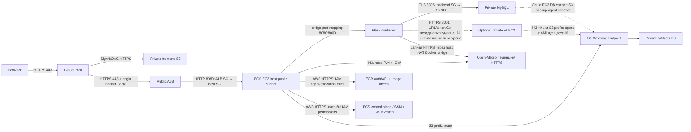

# Network Traffic Diagram

Мережеві напрямки не є Terraform dependencies. Суцільні стрілки нижче мають відповідні subnet/route/SG/origin/port declarations; вони описують дозволений або сконфігурований шлях, НЕ фактично перевірений трафік. Пунктир — неповна інтеграція чи approved-AMI контракт.

ECR image pull виконує container host/agent, а не Flask-код. Containers bridge network не мають окремих public IP; ALB target_type=instance використовує host8080, ECS service вказує container8000. Публічний IPv4 host потрібний для зовнішнього HTTPS, проте ingress до 8080 дозволений тільки ALB SG. EC2/SG не роблять дозволений мережевий шлях працездатним без готового AMI, маршрутизації та application/runtime credentials.

## Security Groups Matrix

| Звідки | Куди | Порт | Джерело підтвердження / стан |
|---|---|---|---|
| CloudFront origin-facing prefix | ALB SG | TCP443 | security.ingress.cloudfront; ALB HTTPS listener; prefix list охоплює всі CloudFront distributions, власну distribution додатково обмежує header |
| ALB SG | Backend SG | TCP8080 | парні ingress/egress targets rules; backend task portMapping8080→8000 |
| Backend SG | MySQL SG | TCP3306 | парні database rules; RDS require_secure_transport=ON, але клієнтський TLS у Flask ще не налаштовано |
| Backend SG | AI SG | TCP8001 | парні inference rules; ECS env не передає ML_SERVICE_URL, тому інтеграцію не підтверджено |
| Backend SG | 0.0.0.0/0 | TCP443 | https egress rule; Open-Meteo та AWS public APIs, не allowlist конкретних доменів |
| AI/MySQL EC2 SG | регіональний S3 prefix | TCP443 | for_each s3 egress rule; лише S3, не ECR/SSM/CloudWatch/apt/pip/Open-Meteo |

SG stateful: відповіді на дозволене вхідне зʼєднання не вимагають симетричного egress rule. RDS не використовує EC2 S3 backup policy: RDS managed backup — сервіс AWS, окрема модель доступу. AWS-provided VPC DNS не слід помилково оголошувати заблокованим лише через відсутність outbound53 rule.

## Routes та публічність

- Public route table:0.0.0.0/0→IGW; public subnet сам по собі не видає IP, map_public_ip_on_launch=false. IPv4 задає ECS host launch template.
- Private route table: default internet route відсутній; локальна VPC маршрутизація та S3 prefix→gateway endpoint. Backend→AI/DB всередині VPC не потребує NAT.
- S3 Gateway endpoint привʼязано до обох route tables. Він не замінює інтернет для Open-Meteo та не дає доступу до всіх AWS API. Endpoint policy не звужена: defaultfullservice access додатково обмежують IAM/bucket policies.
- ALB публічний, але SG звужений до CloudFront443, listener за замовчуванням 403. TLS є Browser→CF→ALB; ALB→backend HTTP, не end-to-end encryption.
- Private AI/EC2 MySQL не мають public IPv4, NAT або interface endpoints. Без approved baked AMI їх неможливо довільно оновлювати через SSM/pip. Наявність IAM policy не створює network egress.
- Route/association readiness не виражена як пряма залежність ASG/ALB від конкретних networking route resources. Не називати порядок subnet→route→host гарантованим лише через membership у module.

Запити/health checks не виконувалися. SG/route аналіз не замінює майбутні connectivity/TLS tests у погодженому AWS середовищі.

Після змін26.11: API origin і маршрут CloudFront→ALB існують тільки при application_window_open; S3/CloudFront — за окремими provisioning gates. Пунктир AI означає неперевірені DNS/TLS/AMI runtime, а не відсутній backend client contract.
