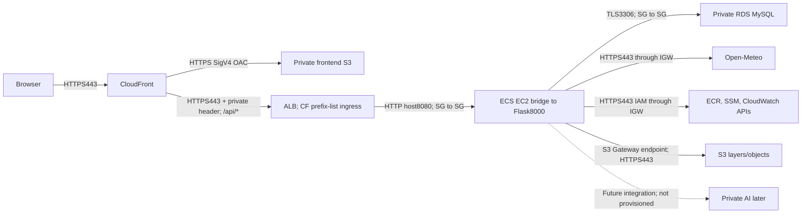

# Network Traffic Diagram — варіант B

Це сконфігуровані/дозволені мережеві потоки, не Terraform DAG і не результати AWS connectivity tests. API-шляхи існують лише deploy_application=true та після фактичного runtime bootstrap.

| Source | Destination | TCP | Обмеження |
|---|---|---|---|
| CloudFront origin-facing prefix list | ALB SG |443| додатково exact header pattern; default403; certificate external issued |
| ALB SG | Backend SG |8080| є ingress і відповідний ALB egress |
| Backend SG | MySQL SG |3306| reader credentials/CA/TLS потрібні окремо |
| Backend SG | IPv4 internet |443| необхідний API/agent egress; це не domain allowlist |

Без NAT/interface endpoints; public EC2 має явну IP у Launch Template, IGW route та закритий inbound крім ALB SG8080. SSH ingress відсутній. Private RDS не має default internet route/public IP; response traffic дозволяє stateful SG. Немає AI SG/API/EC2 — пунктир лише майбутнє рішення, поточний endpoint не готовий. S3 endpoint не замінює Open-Meteo egress. DNS через Amazon resolver, SG не є DNS firewall.
