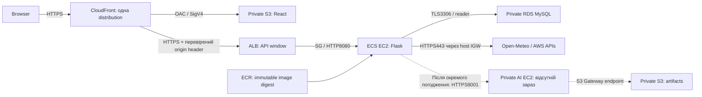

# Пропозиція спрощення ClimateHealth

26.11.2026. **Рекомендовано варіант B: невелика предметна реалізація з адресною адаптацією придатних референсних частин.** Це пропозиція до погодження. Жоден `.tf`, application file, HCP workspace чи Terraform state у цьому аудиті не змінено.

## Три варіанти

Порівнюємо однакову функцію: один Flask workload, приватний RDS MySQL, React у private S3/CloudFront, API через ALB, AI відсутній до появи моделі. Підрахунок blocks і кількість AWS instances — різні речі. Наведені оцінки для майбутніх A/B не є результатом Plan або вже написаного коду.

| Критерій | A — максимальна адаптація референсу | B — мінімальна реалізація ClimateHealth | C — поточний код із точковими виправленнями |
|---|---|---|---|
| Модулі | 10 типів: vpc, security_groups, ecr, ecs, alb, s3, cloudfront, rds, iam_roles, optional ec2. Два S3 виклики: до 11 child calls із AI | 7 типів: networking зі SG, ecr, frontend, mysql, alb, ecs-backend, optional ai. AIoff:6 child modules, із них ALB/backend умовні | 8 типів і до 8 child instances; AI module існує навіть коли його resources count0 |
| Орієнтовні AWS instances, повний demo/AIoff | Приблизно 75–90 після обовʼязкових адаптацій. Розмах через generic IAM policies/attachments, subnet та logging choices. Без натискання Apply це лише design estimate | Близько 64 за конкретними припущеннями нижче, не обіцянка точного Plan | Ручний source expansion71 AWS+1 terraform_data; AI додає 5 AWS, а AI SG/rules і ECR repositories вже створені раніше |
| Root configuration | Більше nested maps/list(object), узгодження старих naming/contracts; не всі defaults безпечні | Ціль 16 root inputs, умовні runtime values; лише один app existence control, desired count і explicit max capacity | 33 root inputs,60 child inputs,11 booleans;3 inputs без default, решта потрібна умовно |
| Переваги | Більше збереженого авторського module layout; менше нового boilerplate для VPC/ASG/ALB | Найзрозуміліші contracts, RDS-only, прозорі Plan та ownership; збережено OAC/SG/TLS | Найменше негайних змін, збереження поточних source addresses і тестів |
| Недоліки | Значна адаптація все одно потрібна: PostgreSQL→MySQL, AL2→AL2023, remote-state removal, OAC, networking. Generic IAM factory потребує виправлення | Новий review і state-aware mapping, цільові static/Validate/Plan перевірки; приріст простоти не дорівнює великій AWS економії | Залишаються ручна state machine, EC2 DB branch, зайві inputs і migration baggage |
| State risk | Найбільше address renames; навіть однаковий AWS resource type не дозволяє сліпо замінити module source | Контрольований: один модуль merge, перенесення log group, адресне видалення непотрібних branches лише після state inventory | Найменший diff, але 22 moves не підтверджені фактичним state; flags продовжують впливати на destroy |
| AWS cost | Та сама базова сума при тих самих AWS ресурсах. NAT/CMK/3 AZ/runner stack із референсу зроблять дорожче, якщо їх залишити | Та сама базова сума. Економія від AIoff/no NAT та контрольованого часу ALB/host, а не числа каталогів | Базовий кошторис уже є; review booleans самі не знижують витрати |
| CI/CD | Потрібно перепроєктувати GitLab/remote-state assumptions під GitHub/HCP | Один власник ECS revisions; Actions для build/test/image/frontend objects, HCP для infrastructure/release reference | HCP ownership уже визначено, але direct UpdateService draft потребує перероблення перед активацією |
| Доцільність | Підходить, якщо головний пріоритет — стандартизація всіх власних проєктів на одному наборі модулів | **Рекомендовано для демонстраційного диплома** | Прийнятний короткий шлях лише якщо рефакторинг відкладено; складність не розвʼязує |

Оцінка B64 отримана від C71: мінус порожній app task role1, мінус AI-specific SG/rules4 і мінус AI ECR repository/lifecycle2 при AIoff. Це не скорочення основного захисту: MySQL/ALB/backend SG залишаються; AI rules повертаються тільки разом із самим AI. Root log group лишається незалежним від application teardown. Розділення/обʼєднання модулів не змінює кількості AWS instances. Нові IAM/observability вимоги можуть змінити оцінку.

## Рекомендована архітектура B

Два public subnets для ALB, два private для RDS subnet group. Backend host — у public subnet із public IPv4; bridge tasks не мають окремих public IP. Inbound host8080 лише від ALB SG. MySQL і майбутній AI — приватні. NAT Gateway/Instance та Kubernetes відсутні. S3 endpoint зберегти для artifact access; він не замінює інтернет чи ECR/SSM endpoints для AI.

Backend: t3.small, один container із 1024 MiB та 512 MiB ECS/OS reserve як початкові кандидати, які ще потребують вимірювань. Fixed8080 і допустимий downtime — найпростіший demo режим. За окремого rolling test дозволити тимчасово другий host, а не збільшувати постійний ресурс. Dynamic hostPort0 можна застосувати пізніше; він не збільшує RAM.

ALB лишається обґрунтованим для узгодженого ECS/HTTPS/health-check маршруту. Без ALB можна зробити дешевше, але доведеться додати власний TLS proxy, стабільний origin, certificate lifecycle та інший deployment/recovery механізм. Це інша архітектура, а не видалення одного дорогого ресурсу без наслідків. Для коротких демонстрацій ALB видаляється тільки через reviewed Manual Apply разом з API origin; S3/RDS не зачіпаються.

## Межі модулів та конкретний reuse

| Ціль | Джерело й дія |
|---|---|
| networking | ADAPT VPC/subnet/route/association patterns із reference/vpc; current SG rules, S3 endpoint та route readiness зберегти. Немає NAT/Redis/bastion/3 AZ defaults |
| ecr | Залишити вже адаптований reference ECR, без CMK/MUTABLE/scanfalse. Створювати backend repo, AI repo — разом із AI |
| frontend | Поточні OAC/distribution/SPA/cache behavior кращі за reference CDN. Для bucket basics можна адаптувати reference/s3 із security/lifecycle виправленнями. Не створювати generic CORS framework |
| mysql | Поточний RDS-only MySQL; PostgreSQL module не копіювати. Забрати EC2 backup/AMI branch після state check |
| alb | Адаптувати reference ALB/TG/listener основу з поточним instance target, matcher200,2 AZ, header403 gate. Виправити header validation |
| ecs-backend | Зберегти потрібний reference cluster/LT/ASG/CP pattern, відкинути Fargate/Spot/discovery/remote_state; current TLS/env/secrets/logging contracts зберегти |
| ai | Коли стане потрібним — адаптована reference/ec2 основа з private SG/IMDSv2/encryptedEBS, без SSH defaults/Owner/AMI ignore. Реальний runtime контракт має бути готовий до host creation |

Окремий generic IAM module зараз не потрібний. Host role та execution role з різними principals залишаються у backend; app task role відсутній, доки app не звертається до AWS API. Не переносити GitLab runner/flow log/FullAccess policies. Existing permissions boundary зберегти, якщо вона є вимогою governance; її optional статус погоджується окремо й не замінює least-privilege IAM.

## Пропоновані 16 root inputs

Це не внесені декларації, а контракт для погодження. Зменшення кількості полів через object не повинно приховувати його вміст.

| Input | Призначення / початковий стан |
|---|---|
| aws_region | Explicit approved region, без credentials. Наразі розраховано us-east-1 |
| environment | dev або production у відповідному workspace |
| name_suffix | Один погоджений suffix, стабільний після deployment |
| vpc_cidr | Default погодженого /16; fixed subnet ranges обчислити через cidrsubnet й перевірити |
| deploy_application | false: немає API compute/ALB/DNS alias/APIorigin. true: створити stateless API resources |
| backend_desired_count |0 або 1. При першому app provisioning0, після CP bootstrap1. Не схвалювати single-apply bootstrap із новим ASGdesired1 |
| backend_max_instances |1 зазвичай,2 лише для погодженого rolling; не прихований автоматичний surge |
| backend_image | null до app gate; далі реальний reviewed immutable ECR digest |
| ecs_ami_id | null до app gate; далі реальний reviewed AL2023 ECS-optimized x86 AMI |
| origin_hostname | null до app gate; далі погоджений DNS hostname |
| origin_zone_id | Existing hosted-zone ID для alias, без купівлі домену/новоїзони |
| origin_certificate_arn | Issued ACM ARN правильного account/region із SAN для hostname |
| origin_verification_header | Sensitive32–128 URL-safe random chars, без wildcard/control |
| runtime_secret_arns |{} до runtime; далі DB_USER/DB_PASS reader ARN та ML_SERVICE_TOKEN лише при AI |
| permissions_boundary_arn | Погоджена існуюча policy, якщо governance її вимагає. Не нова auth envvariable |
| ai | null зараз. Пізніше typed object: ami_id, instance_type, running, service_url, ca_file; реальний DNS/TLS/token contract до активації |

Обʼєкт ai=null означає відсутність AI infrastructure, а не stop вже створеного host. Для створеного AI running=false зберігає instance/EBS; null після provisioning має блокуватися stateful protection/Plan review. Якщо чинний state не порожній, не змінювати цей contract без адресного migration plan. ML model readiness не представляти ще одним TF boolean: перевіряти API contract і health.

## Постійний стан та зупинка

VPC, private S3, ECR, RDS і CloudFront не мають daily provisioning flags. Їх створення відбувається тільки після reviewed Plan/Manual Apply; це платна platform foundation, а не обіцянка «усі false = $0». RDS має backup, deletion protection і prevent_destroy. Повний teardown — окреме рішення з backup/restore.

Backend module можна зробити умовним за deploy_application, **лише винісши retained log group поза цей gate**. Інакше current prevent_destroy log group заблокує вимкнення всього module. Рекомендований root log group — один явний ресурс, не новий observability module. Якщо старий log group уже є у state, потрібний конкретний moved mapping; для порожнього state він не потрібний.

Для швидкої паузи desired_count0 зупиняє tasks/ASG capacity за явним протоколом, але ALB продовжує коштувати. Для завершення демонстрації deploy_application=false прибирає ephemeral backend/ALB/alias і API behavior; platform дані/CDN/logs лишаються. RDS не вимикається creation flag. Після кожного такого Apply перевірити фактичний billing/resource state. Нічого з цього зараз не виконується.

## HCP та CI/CD ownership

Один root `infrastructure/terraform`, без aws/dev/production підкаталогів. Dev/production workspaces — незалежні state, variables, дозволи. Existing AWS authorization лишається як є, без нових TFC_* requirements. Auto Apply off, жодного дубльованого Terraform Apply у Actions.

Два workspaces не означають, що обидва середовища треба створювати одночасно. Для demo спочатку достатньо одного погодженого dev deployment; застосування того самого root у production створить окремі платні ресурси й потребує власного бюджету.

| Обʼєкт / поле | Власник |
|---|---|
| VPC/SG/RDS/ECR/S3 buckets/CF/ALB/ECS infrastructure | HCP Terraform |
| ECS task definition та service.task_definition | HCP Terraform для першої демонстрації |
| Docker image build/tests/ECR digest | GitHub Actions після окремого дозволу на його активацію |
| S3 objects/cache headers/CloudFront invalidation | GitHub Actions; не bucket policies/distribution settings |
| ASG desired capacity | ECS Capacity Provider у межах Terraform min/max; bootstrap із 0 перевірити |
| AI runtime/model deployment | Відкладено; не вигадувати автоматизацію через bool |

Actions build→ECR→digest artifact; оператор переносить перевірений digest у погоджений HCP input, review Plan, Manual Apply. Це простіше за competing UpdateService. Старий draft залишається disabled, доки його не приведено до цієї моделі. Не активувати deployment лише тому, що source tests зелені.

## Вартість

На 26.11.2026 повторно прочитано офіційні [ALB pricing](https://aws.amazon.com/elasticloadbalancing/pricing/) та [VPC IPv4 pricing](https://aws.amazon.com/vpc/pricing/). Для us-east-1 ALB base$0.0225/h, LCUs$0.008/LCU-h; IPv4$0.005/address-h. За умовних 2 ALB IPv4 і 0.1 LCU: `(0.0225 + 2*0.005 + 0.1*0.008)*h` = **$2.664 за 80 h або$24.309 за 730 h**. Actual LCU/IP count може бути вищим. При 1 LCU: $3.24 /$29.565. Це пояснює ціну ALB, а не гарантує bill.

Складові EC2/RDS/S3/ECR/logs/backup/transfer у цьому review наново не переоцінювалися. Попередній [кошторис24.11](../AWS_COST_ESTIMATE.md) за своїх traffic/storage припущень дає t3.small+RDS/AIoff/noNAT/ALB80 h **$24.26**, із 20% **$29.12**;730 h **$62.68**, із 20% **$75.21**. Це історична budget estimate, не нова live quote. За незмінних paid resources A/B/C матимуть близьку суму; B економить час оператора й запобігає зайвим сервісам.

Зупинений backend не прибирає RDS compute/storage/secret, ALB hourly, ECR images, S3 versions, snapshots або logs. AIoff без створення не має AI disk; stopped AI має EBS. При залишенні ALB весь місяць замість 80 h попередня модель додає близько$21.65. Backup/critical data не видаляти автоматично. Не припускати Free Tier або credits coverage; HCP/GitHub/domain/taxes можуть бути окремими витратами. AWS Budgets/alerts — лише пропозиція до окремого дозволу.

## Безпечний план рефакторингу після погодження

1. Отримати дозволений read-only inventory state **обох** workspaces: lineage/serial/resource addresses та version; без експорту secret values у Git. Підтвердити, чи взагалі щось застосовувалося. Зараз це невідомо.
2. Зафіксувати варіант B, bootstrap/stop протокол, ECS ownership та бюджет. Погодити, чи треба зберігати reference naming/contracts для інших власних проєктів.
3. Окремим малим diff виправити origin header validation; додати випадки wildcard/129 chars/правильний URL-safe рядок. Не змінювати auth або SG protection.
4. Перейти на RDS-only тільки після підтвердження, що state не містить EC2 MySQL. Якщо містить — спершу окремий план backup/restore/data migration; не видаляти declarations.
5. Спростити flags і conditional inputs за новим contract; зберегти stateful ресурси незалежно від app gate. Винести log group зі state-aware mapping. Якщо state порожній, не переносити 22 speculative moved у новий код без потреби.
6. За source-to-target матрицею адаптувати лише VPC/ECS/ALB/S3/ECR фрагменти, а не весь reference module tree. Не копіювати remote_state/backend/credentials/foreignpolicy identifiers. Donor hashes до/після мають збігатися.
7. Прибрати unused ALBname та порожній taskrole після перевірки CI callers; обʼєднати security/networking лише якщо це полегшує читання. Відкласти AI-specific resources, явно показати future typed object.
8. Статично перевірити module inputs/outputs, stable resource keys, gates, YAML/JSON/secrets, source hashes. Application tests — якщо торкнуто їхній контракт; їхній успіх не замінює IaC validation.
9. Після окремого дозволу на push врахувати, що VCS може автоматично запустити HCP Plan. Init/Validate/Plan виконувати лише в погодженому HCP workflow. Переглянути moved/replacements/destroys/unknowns/вартість; для stateful ресурсів не повинно бути небажаних destroy.
10. Apply — тільки після нового ручного підтвердження конкретного плану. Перша platform фаза без image/AMI/APIorigin; потім реальний ECR digest, reader/schema/TLS, app desired0, CP bootstrap, після перевірки desired1. Runtime smoke/memory/rolling/restore — окремі acceptance checks. AI лишається off.

Критерій успіху рефакторингу: простіший operator contract, відсутність competing ownership і непотрібних альтернатив, жодної втрати даних/секретів, state-aware diff та перевірений HCP Plan. Число рядків або модулів не є самостійною метою.
